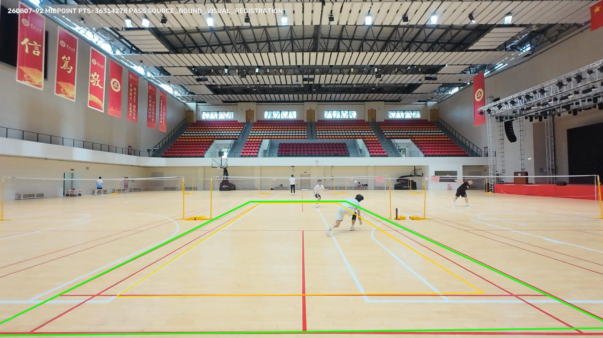
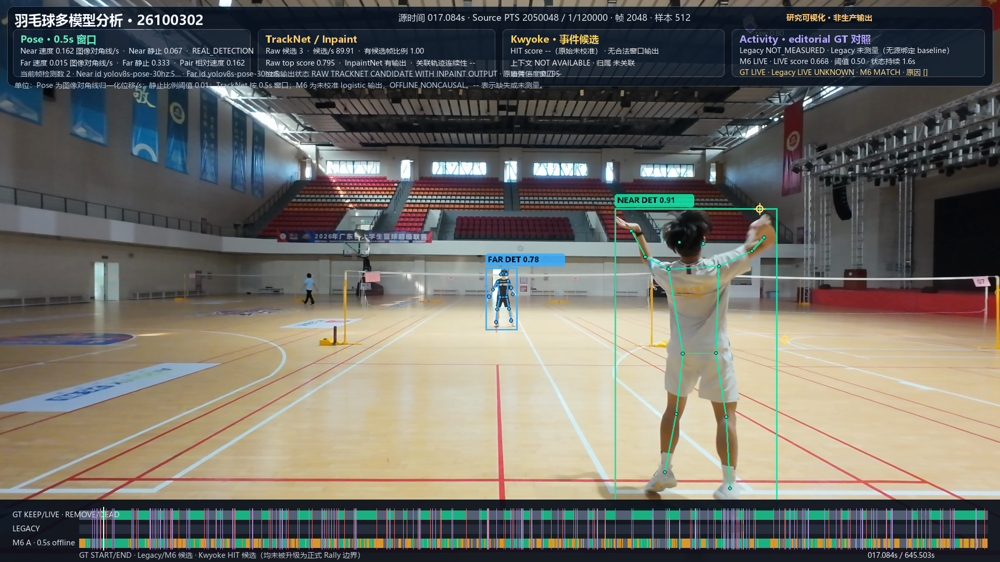
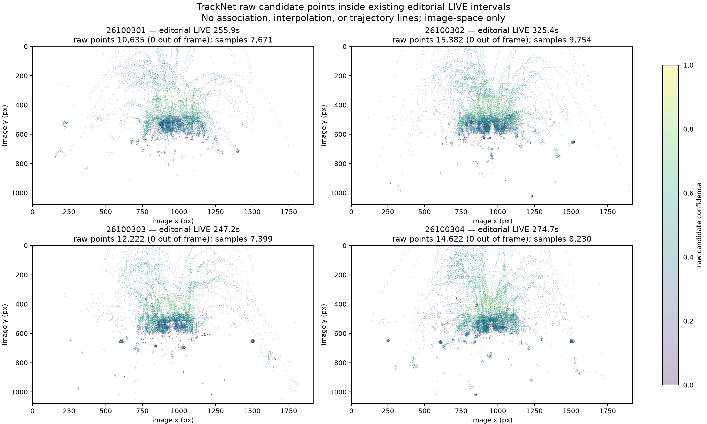
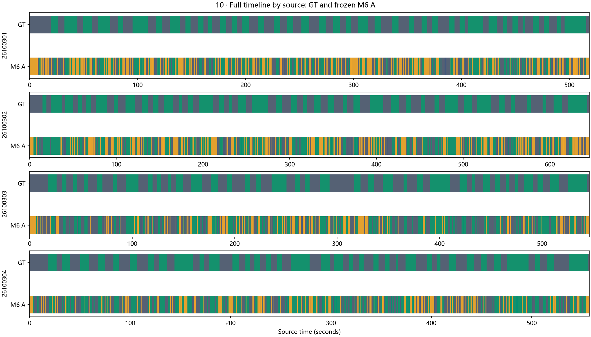

# BadmintonAutoCut

[English](README.md) | [简体中文](README.zh-CN.md)

**A computer-vision research project exploring badminton rally intervals in recorded video.** The research combines court geometry, player detection and Pose, TrackNet V3 shuttle candidates, and temporal modeling of LIVE / DEAD / UNKNOWN activity.

[Project repository](https://github.com/YuCloer/BadmintonAutoCut-Demo) · [Research portfolio](https://yucloer.github.io/BadmintonAutoCut-Demo/) · [Methods](docs/site/methods.html) · [Results](docs/site/research-report.html) · [Complete original report](docs/site/RESEARCH_REPORT.html)

## Research evidence

### Court geometry

### Player detection and Pose

### TrackNet V3 candidates

### Temporal activity

## Research snapshot

The 2026-10-12 offline fusion study compared two distinct model arms on **four videos from one date** (a same-date, research-only comparison). The reference was a human-edited editorial timeline, not physical LIVE/DEAD or Hit truth.

| Offline arm | Balanced accuracy | UNKNOWN | Complete intervals | Precision | Recall | Editorial LIVE lost | Editorial DEAD kept |
|---|---:|---:|---:|---:|---:|---:|---:|
| Tail-safe Player + TrackNet context | 87.75% | 5.08% | 79/148 | 59.85% | 53.38% | 164.33 s | 62.85 s |
| Unguarded Player + TrackNet context | 87.44% | 5.46% | 82/148 | 61.65% | 55.41% | 175.60 s | 51.12 s |

Tail-safe matched three fewer complete intervals, while losing 11.27 fewer seconds of editorial LIVE and keeping 11.73 more seconds of editorial DEAD. Balanced accuracy measures state classification; it is not Rally detection accuracy.

## Method and limits

- The visual examples, Court checkpoint, Tail-safe evaluation, and archived ablation are separate studies, not one production run.
- Raw TrackNet candidates are not temporally associated tracks or verified shuttle trajectories.
- Near/Far are experimental image-y Pose slots, not persistent identities or certified Court-side roles.
- START and END candidates are not formal Rally boundaries unless paired and independently evaluated.
- The four-source comparison is same-date development evidence and does not establish cross-date generalization.
- EventFirst remains the implemented production path with status **`PRODUCTION_NOT_READY`**. The study reports zero accepted production Rally intervals, zero KeepTimeline outputs, and zero new exports.

## Explore the project

- [Bilingual research portfolio](https://yucloer.github.io/BadmintonAutoCut-Demo/)
- [Interactive experiment comparison](https://yucloer.github.io/BadmintonAutoCut-Demo/#experiments)
- [Methods and evaluation scope](docs/site/METHODS.md) · [Rendered methods page](docs/site/methods.html)
- [Reproducibility notes](docs/site/REPRODUCIBILITY.md) · [Rendered provenance page](docs/site/reproducibility.html)
- [Evidence manifest](docs/site/evidence-manifest.json)
- [Complete original research report (Chinese)](docs/site/RESEARCH_REPORT.html)

The public repository contains selected still images and aggregate study results. It does not include source video, model weights, raw caches, or annotation files, so the numerical evaluation cannot be rerun from this repository alone.
