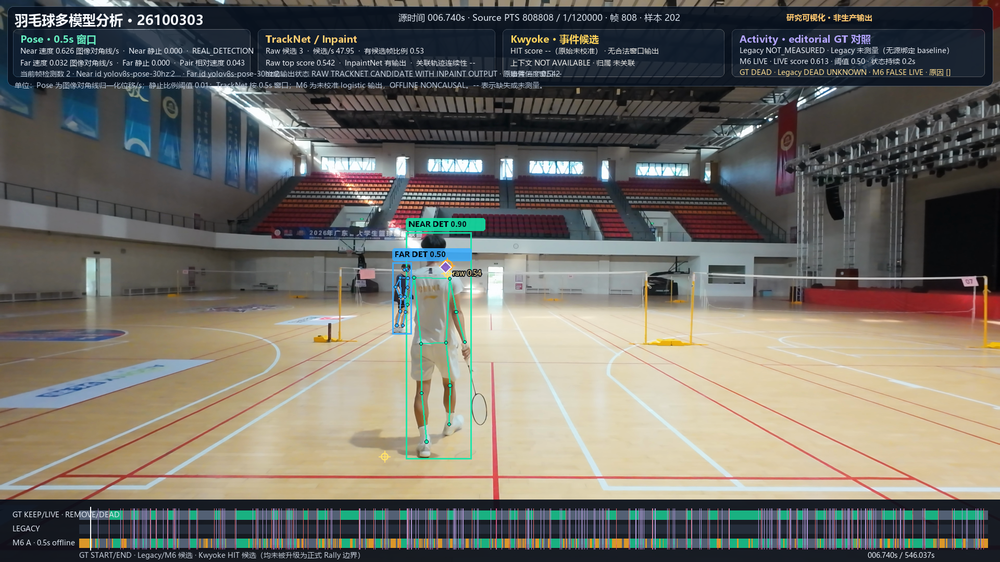
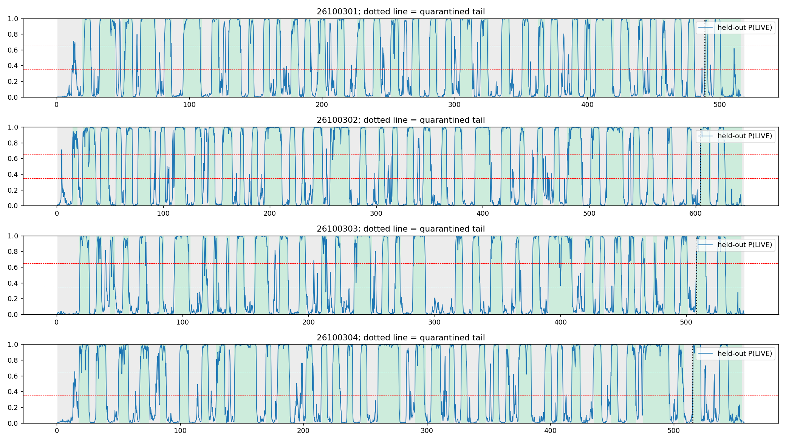
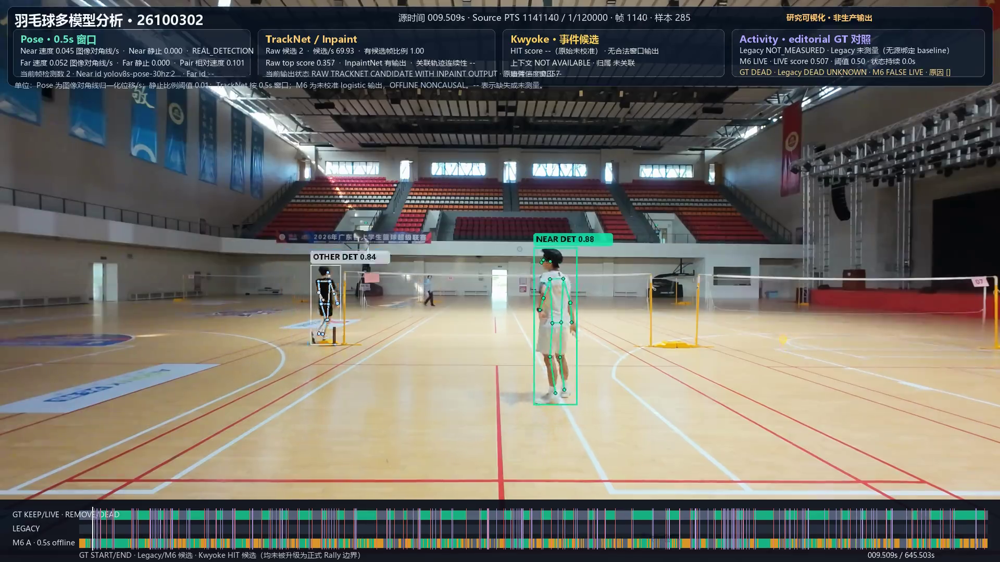
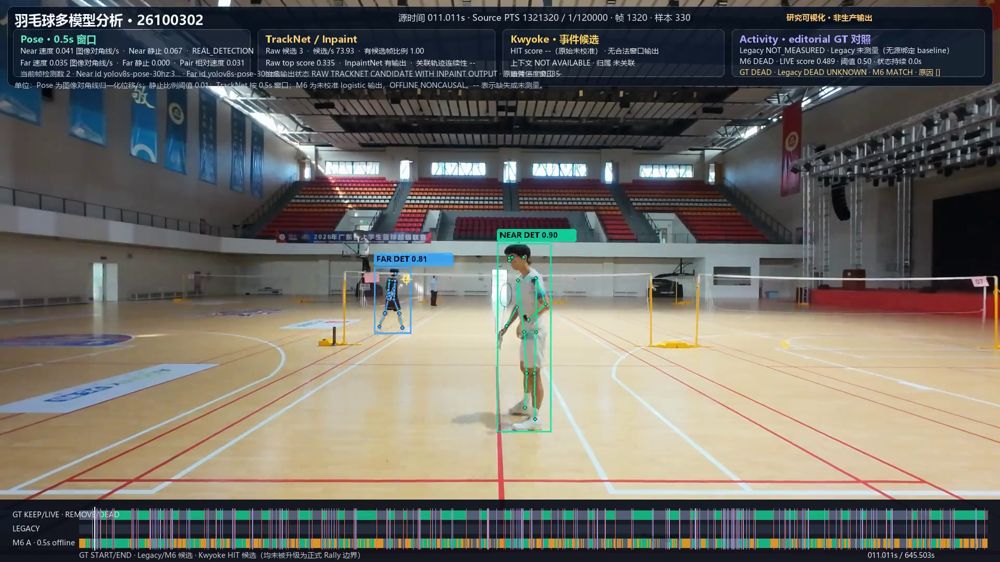
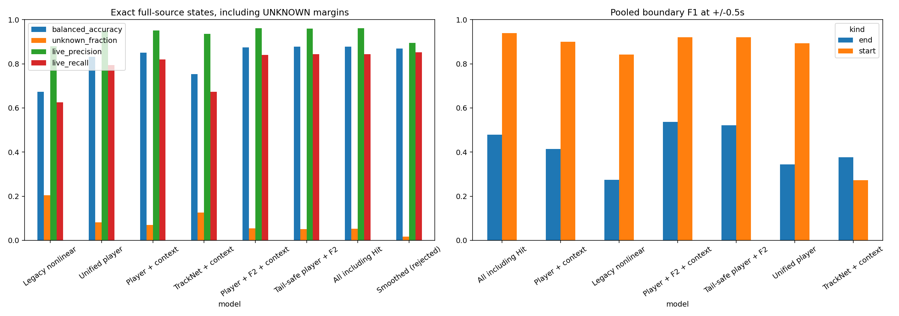
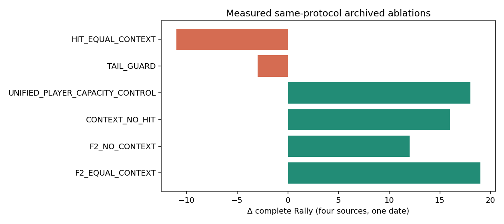

# BadmintonAutoCut — Research Evidence Showcase

**Automatic Badminton Rally Detection &amp; Video Editing**

Real computer-vision evidence from badminton video research: Court calibration, player boxes and Pose, TrackNet V3 candidates, LIVE/DEAD/UNKNOWN timelines, boundary candidates, model comparisons, and failure cases.

中文简介：本仓库集中展示 BadmintonAutoCut 已有的真实视觉研究素材。首页直接嵌入原始场地图、Pose、TrackNet 候选点、时间线和实验对比；完整来源与限制见[在线研究图库](https://yucloer.github.io/BadmintonAutoCut-Demo/)。

**[Open the visual evidence gallery](https://yucloer.github.io/BadmintonAutoCut-Demo/) · [Full research report](docs/site/RESEARCH_REPORT.html) · [Methods](docs/site/METHODS.md) · [Repository](https://github.com/YuCloer/BadmintonAutoCut-Demo)**

> **Research showcase — not production certification.** The frame examples and M6 studies are historical offline visualizations. EventFirst remains the implemented production path with status `PRODUCTION_NOT_READY`. The displayed results do not certify Rally, KeepTimeline, or video export acceptance.

## Research pipeline and production boundary

```text
1080p video → Court geometry → CurrentCourt evidence → Player / Pose
            → TrackNet V3 candidates → LIVE / DEAD / UNKNOWN study
            → START / END candidates → Rally → KeepTimeline → export
```

This diagram describes the research problem stages. The gallery shows outputs from several distinct historical experiments; it does not imply that every stage is connected or has passed production gates. M6 is an offline, noncausal research model. EventFirst is the current production path, and its release state remains `PRODUCTION_NOT_READY`.

## Visual evidence — five distinct evidence types

All images below are selected research-only repository assets. Click any image to open the full-resolution file. Figure captions preserve Source ID, model/stage, experiment status, GT-versus-prediction identity, and limitations.

### A. Source video and Court calibration

[](docs/site/assets/evidence/court-260807-92-midpoint.jpg)

*Source `260807-92`, 2026-08-07, 302.619 s, PTS 36,314,278 / frame 36,278. `automatic_court_evidence_v1`: midpoint geometry PASS and source-bound registration PASS. This is a checkpoint example, not all-frame Court, Rally, KeepTimeline, or export certification.*

### B. Player boxes, Pose skeletons, and Near/Far slots

[](docs/site/assets/evidence/m6-live-match-26100302-017-084s.png)

*Source `26100302`, 2026-10-03, 17.084 s, PTS 2,050,048 / frame 2,048. `M6_POSE_MOTION_PLUS_TRACKNET`; frozen zero-shot parameters with no target-GT tuning. Editorial GT LIVE / M6 LIVE-MATCH. Near/Far are experimental image-y slots, not persistent identity or Court-side labels.*

### C. TrackNet candidates over a real frame and four-source spatial distribution

[](docs/site/assets/evidence/m6-false-live-26100303-006-740s.png)

*Source `26100303`, 6.740 s, PTS 808,808 / frame 808. The raw TrackNet candidate and Pose detections are from a frozen zero-shot render. Editorial GT DEAD / M6 FALSE LIVE. This is an actual failure example; the point is not a verified flight path.*

[](docs/site/assets/evidence/tracknet-raw-scatter-four-source.png)

*Original 2700×1620 scatter from the frozen TrackNet candidate table: `26100301` 10,635 points; `26100302` 15,382; `26100303` 12,222; `26100304` 14,622; **52,861 total**. Existing editorial LIVE intervals select the time subset. Points are unassociated image-space candidates, not trajectories; no interpolation or CurrentCourt status is implied.*

### D. LIVE/DEAD/UNKNOWN timelines and START/END evidence

[](docs/site/assets/evidence/m6-gt-state-timeline-four-source.png)

*Four-source M6 A state timeline, 2026-10-03. Separate rows show editorial GT and model states. The original generator maps LIVE to green, DEAD to slate, and UNKNOWN to amber. This is an M6 research output.*

[](docs/site/assets/evidence/tail-safe-probability-timeline-four-source.png)

*A separate report arm, `PLAYER_TRACKNET_CONTEXT_TAIL_SAFE`, shows held-out P(LIVE) over four sources from one date. Its probability curves are not the M6 A categorical timeline above.*

[](docs/site/assets/evidence/m6-26100302-start-candidate-009-510s.png)

*START candidate event time 9.500 s; nearest sampled frame 9.5095 s, PTS 1,141,140 / frame 1,140. Editorial GT DEAD / sampled M6 FALSE LIVE. Candidate only; not a formal Rally boundary.*

[](docs/site/assets/evidence/m6-26100302-end-candidate-011-011s.png)

*END candidate event time 11.000 s; sampled frame 11.011 s, PTS 1,321,320 / frame 1,320. The sampled frame is editorial GT DEAD / M6 DEAD. Candidate only; no formal boundary association is asserted.*

### E. Model performance and ablation comparison

[](docs/site/assets/evidence/model-performance-comparison-four-source.png)

*Original offline report figure for four sources from one date. It compares balanced accuracy, UNKNOWN, LIVE precision/recall, and pooled START/END F1 at ±0.5 s across research arms.*

[](docs/site/assets/evidence/ablation-delta-complete-rally-four-source.png)

*Archived table-produced ablations from a separate 2026-10-13 report, four sources and one date. This count-delta chart is not the same metric as the tail-safe report's 79/148.*

## Offline results and experiment scope

| Arm | Balanced accuracy | UNKNOWN | START | END | Complete editorial boundary pairs matched | Precision | Recall | Editorial LIVE lost | Editorial DEAD kept |
|---|---:|---:|---:|---:|---:|---:|---:|---:|---:|
| `PLAYER_TRACKNET_CONTEXT_TAIL_SAFE` | 87.75% | 5.08% | 139/148 | 93/148 | 79/148 | 59.85% | 53.38% | 164.33 s | 62.85 s |
| Unguarded `PLAYER_TRACKNET_CONTEXT` | 87.44% | 5.46% | 138/148 | 100/148 | 82/148 | 61.65% | 55.41% | 175.60 s | 51.12 s |

These are offline editorial-timeline metrics for four video sources from a single date. `79/148` and `82/148` belong to different arms. Neither is a production Rally-export count; accepted formal Rally/KeepTimeline/export results for this study are zero. The separate Court example and the archived ablation chart are not part of this metric cohort.

## Failure cases and limitations

- Source `26100303` shows editorial GT DEAD with an M6 FALSE LIVE prediction and raw TrackNet candidates overlaid on the real frame.
- Source `26100304` shows UNKNOWN with a missing Far pose slot near the beginning; its last mapped sample also retains UNKNOWN and missing pose observations.
- The first Kwyoke event on source `26100302` is a `HIT_CANDIDATE` with `physical_hit_verified=false`; it is not a verified physical Hit or Rally boundary.
- No trustworthy Near/Far identity role-swap example was found. The Oct 3 model has image-y slot ordering, not persistent identities.
- No reliable current TrackNet V3 interpolation/prediction screenshot with selected coordinates was found. Historical states without current selected coordinates are not presented as V3 detections.
- The Oct 3 M6 images, Oct 12 tail-safe report, Oct 13 ablation, and Aug 7 Court checkpoint are separate evidence scopes. Same-date results do not establish cross-date generalization.

The [visual evidence gallery](https://yucloer.github.io/BadmintonAutoCut-Demo/) includes source-attributed examples, original report charts, and the full standalone report. See [methods](docs/site/METHODS.md), [reproducibility notes](docs/site/REPRODUCIBILITY.md), and the [evidence manifest](docs/site/evidence-manifest.json).

## Privacy and license scope

This repository publishes selected stills and research figures only. It includes no source videos, video proxies, model weights, raw caches, full annotation files, or personal identity data. The MIT license covers the viewer/documentation code only; it does not grant rights to source footage, model checkpoints, annotations, or third-party assets.
